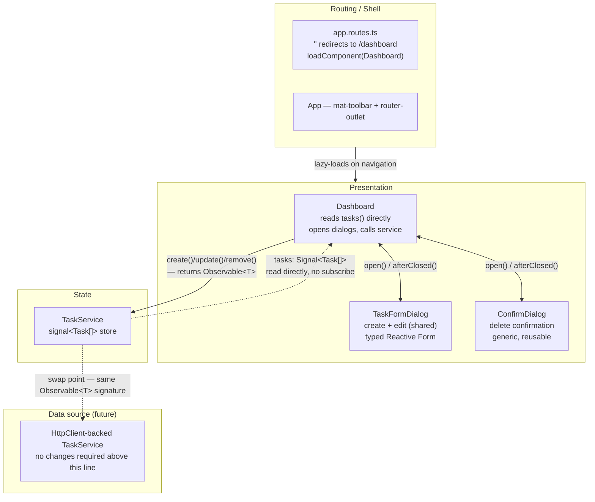

# Task Dashboard — Implementation Plan

Scope: a CRUD "Tasks" dashboard for `angular-agent`, built as an Angular 22 standalone feature, checked against the coding standards in [`AGENTS.md`](./AGENTS.md).

## Scope & decisions

Settled during scoping, before any code was written:

| Decision | Answer |
|---|---|
| Entity | `Task` — `id`, `title`, `description`, `status`, `createdAt` |
| Data layer | In-memory `signal<Task[]>` store, seeded with 3 tasks; mutation methods return `Observable` to leave an HTTP swap-in seam |
| Routing | `/dashboard`, lazy-loaded via `loadComponent`; `''` redirects to it |
| UI library | Angular Material (M3 `mat.theme()`, azure/blue palette) |
| Layout | One list page (table) + a shared dialog for create/edit |
| Forms | Typed Reactive Forms |
| Delete | `MatDialog` confirm, not native `confirm()` |
| Tests | Out of scope for this pass (explicit call, not an oversight) |

## Architecture layers

Four layers, top to bottom. The seam that matters is between **State** and the (future) **Data source**: every write already goes through an `Observable`-returning method, so swapping the in-memory store for a real `HttpClient` call later touches nothing above that line. Dashboard is the only component that talks to `TaskService` — the dialogs are data-in/data-out and never see it.



## Data flow — editing a task

One concrete, representative path through the system. Create follows the same shape minus the prefill step; delete replaces steps 2–5 with `ConfirmDialog` and step 6 with `remove(id)`.

```mermaid
sequenceDiagram
    actor User
    participant Dashboard
    participant TaskFormDialog
    participant TaskService

    User->>Dashboard: 1. click ✎ edit icon
    Dashboard->>TaskFormDialog: 2. MatDialog.open(TaskFormDialog, {data:{task}})
    Note right of TaskFormDialog: 3. form prefilled from data.task
    User->>TaskFormDialog: 4. edits fields, clicks Save
    TaskFormDialog->>Dashboard: 5. dialogRef.close(formValue) → afterClosed() emits TaskDraft
    Dashboard->>TaskService: 6. taskService.update(id, draft)
    Note right of TaskService: 7. tasksSignal.update(...) — mutate array
    TaskService-->>Dashboard: 8. returns Observable&lt;Task&gt; — of(updated)
    Note left of Dashboard: 9. table re-renders — tasks() read in template
```

## File-by-file plan

| File | Responsibility |
|---|---|
| `dashboard/task.ts` | `Task` model, `TaskStatus` union, `TaskDraft` derived via `Pick` |
| `dashboard/task.service.ts` | Signal-based store; seeds 3 tasks; `create`/`update`/`remove` return `Observable` |
| `dashboard/dashboard.ts/.html/.scss` | Table of tasks, Add Task entry point, orchestrates both dialogs |
| `dashboard/task-form-dialog/` | Shared create/edit dialog, typed Reactive Form, `MAT_DIALOG_DATA`-driven mode |
| `dashboard/confirm-dialog/` | Generic reusable confirm dialog, used for delete |
| `app.routes.ts` | `''` → `/dashboard` redirect; lazy `loadComponent` |
| `app.config.ts` | `provideRouter`, `provideAnimationsAsync` |
| `app.ts` / `app.html` | Minimal shell: `<mat-toolbar>` + `<router-outlet>` |
| `AGENTS.md` | The coding standards this plan is checked against |

## Coding standards compliance

Every rule in `AGENTS.md`, checked against what actually shipped.

| Standard | Where applied | |
|---|---|---|
| Standalone components, no `NgModule`s | All 5 components declare their own `imports: []` | ✓ met |
| No `Component` suffix on class names | `Dashboard`, `TaskFormDialog`, `ConfirmDialog`, `App` | ✓ met |
| Colocated template/style files, one folder per multi-file component | `task-form-dialog/`, `confirm-dialog/` each own their files | ✓ met |
| `@if` / `@for`, not `*ngIf` / `*ngFor` | Used throughout `dashboard.html` and `task-form-dialog.html` | ✓ met |
| `inject()`, not constructor params | All services/dialog refs injected with `inject()` | ✓ met |
| Signal-based service, no state library | `TaskService` — no NgRx | ✓ met |
| Reads exposed as `Signal<T>`, writes return `Observable<T>` | `tasks: Signal<Task[]>` vs. `create/update/remove(): Observable<T>` | ✓ met |
| Typed, non-nullable Reactive Forms | `FormGroup<TaskForm>` with `nonNullable: true` controls | ✓ met |
| One shared form for create + edit | Single `TaskFormDialog`, mode via `MAT_DIALOG_DATA` | ✓ met |
| Lazy-loaded feature routes | `loadComponent` in `app.routes.ts` | ✓ met |
| Material over hand-rolled UI; `MatDialog` for destructive confirm | Table, dialog, form field, buttons all Material; delete goes through `ConfirmDialog` | ✓ met |
| Theme via `--mat-sys-*` tokens, not hardcoded Material internals | `dashboard.scss` empty-state color uses `var(--mat-sys-on-surface-variant)` | ✓ met |
| Kebab-case file names, one concern per file | `task-form-dialog.ts`, dialog data interfaces live next to their component | ✓ met |
| Vitest coverage for service mutations + form validators | Explicitly scoped out of this pass, see follow-ups | △ deferred |

## Known issues & follow-ups

Honest gaps, not silently swept into "done":

1. **Delete button color.** `color="warn"` on the `ConfirmDialog`'s delete button renders primary blue instead of red under the M3 `mat.theme()` system — cosmetic, not functional. Worth a look if visual severity cues matter later.
2. **`@angular/animations` is deprecated** in Angular 22 in favor of `animate.enter`/`animate.leave`, but it's still required today for `provideAnimationsAsync()` and Material's dialog/ripple motion. Revisit if Angular removes the package outright.
3. **No automated tests yet.** Deferred by an explicit decision during scoping, not an oversight — `TaskService` CRUD methods and `TaskFormDialog` validators are the two things worth covering first when tests are back in scope.
